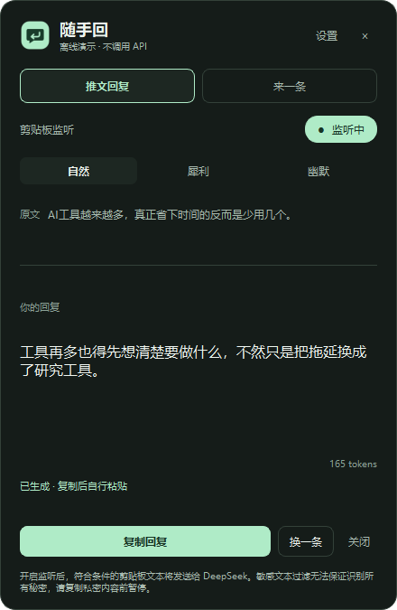
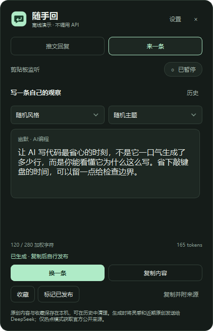
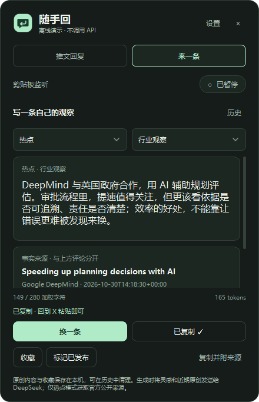

# 随手回 | SuishouReply

**推文回复，随手来一句；原创内容，点一下来一条。**

随手回是一款 Windows 桌面中文写作助手，面向 **X 账号冷启动、日常互动和原创表达**。同一个原生浮窗提供两个入口：**「推文回复」**根据你主动复制的推文生成简短评论；**「来一条」**面向「AI信号局」这类关注 AI 工具、开源项目与行业变化的账号，不依赖剪贴板，一次生成一条自己的观察。

提示词着重减少 AI 模板腔、空洞附和和营销式表达，帮助你更快写出适合当前讨论的评论。生成内容仍需由你审核和修改。应用不承诺涨粉效果，也不提供批量营销功能。

[已发布的 v1.0.0 Windows 版](https://github.com/shui234/suishou-reply/releases/tag/v1.0.0) · [更新记录](CHANGELOG.md) · [测试报告](docs/TEST_REPORT.md) · [维护与发版](docs/UPDATING.md)

本文说明本地 **v1.1.0** 的功能。v1.1.0 尚未发布到 GitHub Releases；上方下载链接仍为只含回复流程的 v1.0.0。本地交付包为 `SuishouReply-1.1.0-Windows.zip`。当前工作区的新 EXE 在 `dist-v1.1.0/SuishouReply.exe`；压缩包内统一放在 `SuishouReply/dist/SuishouReply.exe`。升级前请从系统托盘退出正在运行的旧版，再启动新版；原有密钥和设置继续复用。

## 界面预览







*真实原生应用界面的离线模拟截图。原文、原创内容和 token 数为模拟数据，不是付费 DeepSeek 调用结果。热点卡片使用实际获取的官方来源元数据，评论为合成测试内容。*

## 核心功能

| 功能 | 使用方式 |
| --- | --- |
| 复制后生成 | 手动开启监听，再复制一段推文正文，得到一条中文回复 |
| 三种语气 | **自然**：平实参与；**犀利**：补充不同角度、指出漏洞；**幽默**：轻松表达、不硬玩梗 |
| 轻量浮窗 | 可拖动、不抢输入焦点；系统托盘随时找回，支持深色与浅色主题 |
| 手动换一条 | 针对当前原文再次生成，提示模型换一个角度 |
| 复制回复 | 只复制回复正文，由你检查、修改并发布 |
| 一键原创 | 不需要复制推文，点击「来一条」生成一条可直接审阅的中文原创 |
| 风格与主题 | 默认随机；原创风格可选犀利、幽默、反常识、热点，主题可选 AI工具、GitHub开源、模型更新、AI编程、AI Agent、行业观察 |
| 热点有出处 | 明确选择「热点」才获取近期官方来源；来源标题、日期、摘要和原始链接与评论分开显示 |
| 原创历史 | 查看本地历史，筛选收藏／已发布记录，打开旧内容再次复制；支持确认后清空 |
| 默认暂停 | 启动、进入设置或切换到「来一条」时暂停监听；返回回复模式后需要手动开启 |
| 安全保存密钥 | API Key 交给当前 Windows 用户的凭据管理器，本地配置不保存明文密钥 |

回复提示词要求最多两句话、通常 30～80 字。原创提示词偏好 50～110 字、1～3 句，表达具体观察，避免编造亲历、虚构新闻和空洞口号；单条输出经过格式和长度检查。实际措辞与事实准确性仍需你审核。

## 适合哪些场景

- **X 账号冷启动**：找到与你关注领域相关的讨论，减少从空白开始写评论的时间。
- **日常互动**：浏览关注列表时，快速整理认可、补充或质疑的表达。
- **参与热门话题**：你自己选择话题和推文，随手回帮助组织一条贴合原文的回复。
- **调整表达方式**：在自然、犀利和幽默之间切换，找到更符合自己语气的说法。
- **AI信号局的原创选题**：从工具选择、开源维护、模型更新、AI 编程、Agent 与行业观察中挑一个角度，完成一条短内容。

回复流程通过系统剪贴板接收文字；原创流程使用本地选题，显式选择「热点」时才访问白名单中的公开官方消息源。应用不登录 X、不读取你的浏览器页面、不打开评论框，也不自动操作账号或发帖。每条内容是否使用、如何修改、何时发布，都由你决定。「已发布」只是本地管理标记，不会发送内容。

## 安装 Windows 版

运行版无需安装 Python，也无需管理员权限。当前构建为 Windows x64，在 Windows 11 x64 上完成验证。

1. 已发布版本可从 [v1.0.0 Releases 页面](https://github.com/shui234/suishou-reply/releases/tag/v1.0.0) 的 Assets 下载 `SuishouReply-1.0.0-Windows.zip`。该版本不含「来一条」；v1.1.0 使用本地交付的构建包或下文源码构建。源码与已发布包公开提供，无需 GitHub 登录即可下载。
2. 将 ZIP **完整解压**到一个目录，保留构建信息与许可文件。
3. 双击解压后的 `SuishouReply\dist\SuishouReply.exe`，首次启动会打开设置。

发布包以 Releases 页面实际提供的资产为准；GitHub 自动生成的 Source code 压缩包是源码，不包含可直接运行的 EXE。

发布包包含源码和 `dist/` 运行目录。当前 EXE 未做代码签名。若 Windows SmartScreen 提示未知发布者，请先核对下载来源及 `dist\SHA256SUMS.txt` 中的校验值，无需关闭系统安全防护。可在解压后的 `SuishouReply\dist` 目录运行：

```powershell
Get-FileHash -LiteralPath .\SuishouReply.exe -Algorithm SHA256
Get-Content -LiteralPath .\SHA256SUMS.txt
```

单文件 EXE 首次启动会将运行库解压到系统临时目录，可能略慢。关闭浮窗只会隐藏窗口；可在系统托盘找回，或从托盘菜单退出。

## 配置 DeepSeek 并开始使用

两个模式共用同一份 DeepSeek 密钥与模型设置。

1. 在 [DeepSeek 官方平台](https://platform.deepseek.com) 创建自己的 API Key，粘贴到应用设置的密钥输入框。不要将密钥写入源码、截图、Issue 或聊天记录。
2. 检查模型名，点击 **「测试连接」**。它使用输入框中的密钥发送固定测试文本，不发送当前剪贴板；会产生一次正常 API 调用。应用不赠送 API 额度。
3. 测试成功后点击 **「保存设置」**。密钥存入 Windows 凭据管理器，监听仍保持暂停。
4. 回到浮窗，点击 **「已暂停」** 开启监听。
5. 在浏览器中主动复制一段 **12～3000 字**的推文正文。开启监听不会处理此前已经存在的剪贴板内容。
6. 阅读生成的回复，核对事实、语气及上下文。需要不同角度时点 **「换一条」**。
7. 点击 **「复制回复」**，自行粘贴到 X 评论框，按需修改，再手动发布。

默认模型名为 `deepseek-flash`；可在设置中填写自己账户可用的模型名。当前实现固定请求 `https://api.deepseek.com/chat/completions`，关闭思考模式、非流式返回，30 秒超时。账户支持的模型、余额和服务状态以 DeepSeek 平台为准。

接口参考：[官方接入文档](https://api-docs.deepseek.com/)、[思考模式参数](https://api-docs.deepseek.com/guides/thinking_mode/)、[错误码说明](https://api-docs.deepseek.com/quick_start/error_codes/)。

## 来一条：原创内容流程

1. 点击浮窗上方 **「来一条」**。应用会暂停剪贴板监听，界面仍显示全局「已暂停」状态；此模式不读取已复制的推文来创作。
2. 保持默认 **随机风格／随机主题**，或选择具体风格和主题。随机风格只在犀利、幽默、反常识中选择，**不会随机触发热点联网请求**。
3. 点击 **「来一条」**。应用从 20 个本地主题、60 个具体角度中选择素材，并参考近期原创历史减少重复；一次请求只生成一条结果。
4. 阅读完整内容，检查事实、表达和页面显示的加权字符数。需要另一个角度时点 **「换一条」**；生成中可点「取消」。
5. 点击 **「复制内容」**，回到 X 自行粘贴、修改和发布。可收藏内容，或手动标记「已发布」。
6. 点击 **「历史」** 查看全部、收藏或已发布记录。选中记录后点「查看内容」，可再次复制。清空／重置历史需要在应用内明确确认。

原创请求使用 JSON 结构化输出、`max_tokens=512`、非流式返回、30 秒超时，不启用自动重试。输出无效、超长、重复或请求失败时会显示错误，是否再次调用由你决定。计费仍按服务端实际处理情况计算，取消不保证免计费。

长度检查采用保守的 X 加权字符计算，目标上限 **280**；中文和多数 emoji 通常占 2，普通拉丁字符通常占 1，URL 按链接权重计算。热点内容同时检查正文及附来源链接版本。页面显示正文长度；「复制并附来源」会在正文后附原始来源链接，平台最终的编辑框计数为准。

切回「推文回复」不会自动恢复监听，需要你手动开启，之后只处理新的复制内容。

## 热点：先有来源，再写观察

只有明确选择 **「热点」** 风格时，应用才请求固定白名单中的官方 RSS 或 GitHub 官方项目发布记录。普通原创使用本地灵感，不查询新闻，也不把静态知识包装成实时消息。

当前来源包括 OpenAI 官方新闻、Google DeepMind 官方博客、OpenAI Agents SDK 与 Anthropic Claude Code 的官方 GitHub Releases。来源必须包含标题、原始链接、可核验的发布时间和摘要／发布说明，限定为 **最近 14 天**，排除无日期、未来日期、过期和不完整条目。具体网络边界与验证结果见 [测试报告](docs/TEST_REPORT.md)。

来源卡片单独列出标题、日期、提供方和事实摘要，可点击「打开原始来源」核对。上方内容卡片是生成的观察评论，不等同于来源原文；复制时可选择纯正文或附来源链接的版本。

若没有符合时间和主题条件的可信来源，或来源网络不可用，应用会解释失败并停止热点生成；不会虚构来源，也不会自动降级成看似最新的普通内容。你可以稍后重试，或主动切回其他风格。

## 不用密钥，先试离线演示

在解压后的 `SuishouReply\dist` 目录打开 PowerShell，运行：

```powershell
& .\SuishouReply.exe --demo
```

也可双击解压后的 `SuishouReply\demo.bat`。演示窗口有「离线演示」标记，使用模拟内容和模拟 token 数，不访问 DeepSeek、不读取或写入真实密钥，也不保存真实设置和原创历史。回复演示需先开启监听，再复制一段示例文字：

> 现在的 AI 工具越来越多，但真正难的似乎不是找到工具，而是想清楚自己究竟要解决什么问题。

演示可检查回复、原创、换一条、复制、收藏／已发布标记和历史筛选流程。离线演示不获取热点新闻，选择热点会显示相应提示。模拟内容不代表模型对当前文字或真实事件的判断。

## 剪贴板、隐私与请求行为

**开启监听后，符合条件的新剪贴板文本会发送给 DeepSeek；应用无法判断文字是否来自 X。复制私人内容前请暂停监听。**

- **输入过滤**：只处理 12～3000 字文本，跳过图片、文件、纯链接、路径、纯数字、邮箱、明显代码及部分疑似密钥、密码和验证码。规则可能漏掉敏感内容，也可能误拦普通文字，并非完整的敏感信息识别系统。
- **回复发送范围**：发送所复制的文本、回复指令，以及点击「换一条」时的上一条回复。生产服务地址固定为 DeepSeek 官方 HTTPS 接口，不支持自定义 API 地址，不跟随重定向。
- **原创发送范围**：发送所选风格、主题、本地选题指令和近期原创内容；热点模式另发送所选官方来源的标题、日期、摘要及链接。原创生成不发送剪贴板文本。新闻请求不携带 DeepSeek 密钥或用户内容。
- **本地存储**：API Key 保存在 Windows 凭据管理器的 `SuishouReply/DeepSeekAPI` 中，保存失败不会降级为明文，可在设置中删除。`%LOCALAPPDATA%\SuishouReply\settings.json` 仅保存模型名、风格和主题。
- **回复留存**：不保存复制的推文或回复历史，不写入原文、回复或密钥日志。当前原文与回复暂存于运行内存，用于显示和换一条；暂停或退出会清空应用内当前回复内容。
- **原创留存**：成功生成的原创正文、风格、主题、选题角度、来源及收藏／已发布标记，单独保存到 `%LOCALAPPDATA%\SuishouReply\original-history.json`。保留最近 200 条及较早收藏，最多 500 条；不会把复制的推文写进原创历史。历史是本地可读 JSON，不含 API Key。可在「历史」内确认清空；文件损坏或无法保存时会显示错误，不会静默覆盖现有记录。
- **剪贴板与第三方处理**：Windows 剪贴板历史、同步及 DeepSeek 的数据处理受各自设置和政策影响。复制任何生成内容都由用户主动点击；应用会防止这些内容再次触发自动回复生成。
- **请求调度**：350 毫秒防抖，连续复制优先处理最新内容；新内容或暂停会取消旧任务，过期结果不会覆盖当前内容。会话内通过摘要去重，复制回复不会循环触发生成。
- **调用与计费**：网络错误不会自动重试。需要重新生成时手动操作；取消本地请求不能保证服务端尚未处理或计费。

## 常见问题

| 现象 | 检查方法 |
| --- | --- |
| 复制后没有回复 | 确认监听已开启，再重新复制；检查长度及过滤规则。开启监听不会发送旧剪贴板 |
| 提示内容已处理 | 相同内容在本次运行内不会自动重复调用，需要时点击「换一条」 |
| API Key 无效 | 在设置中输入正确密钥，测试成功后保存 |
| 余额不足 | 到 DeepSeek 官方平台检查自己的账户余额 |
| 请求过于频繁 | 稍后主动重试；应用不会自动重复请求 |
| 超时或网络错误 | 检查本机网络，在设置中重新测试连接 |
| 热点没有生成内容 | 检查是否存在最近 14 天且符合所选主题的官方来源；可稍后重试，或手动改用其他风格 |
| 原创输出无效、超长或重复 | 本次结果未作为正常内容展示；点「来一条／换一条」主动重试，不会自动重复扣费调用 |
| 原创历史无法读取或保存 | 检查本地配置目录权限；需要重置时进入「历史」→「清空／重置历史」并确认，原记录和标记会删除 |
| 切回回复后没有监听 | 进入原创会暂停监听，切回后请手动开启并重新复制 |
| 保存设置失败 | 检查当前用户的 Windows 凭据管理器及本地配置目录是否可用 |
| 找不到浮窗 | 展开 Windows 系统托盘隐藏图标，点击随手回 |
| Releases 页面显示 404 | 检查仓库地址与版本号，或从仓库首页进入 Releases |

错误界面不会直接显示服务端原始返回正文或密钥。

## 从源码运行

实际开发与验证环境为 **Windows 11 x64、Python 3.14.4**。启动脚本接受 64 位 Python 3.11～3.15，此范围依据固定 Qt wheel 的版本元数据，未逐一验证所有版本。

1. 从 [Python 官方网站](https://www.python.org/downloads/windows/) 安装 64 位 Python，保留 Python Launcher 或将 Python 加入 PATH。
2. 克隆或下载完整源码，双击 `start.bat`。
3. 首次运行会创建项目内 `.venv`，联网安装固定依赖，成功后保存安装标记；后续启动检查环境后直接运行。

路径可包含空格和中文。移动源码目录后若虚拟环境失效，可重命名项目内 `.venv` 并重新启动；Windows 凭据管理器中的密钥不会随项目目录移动而删除。

| 技术 | 用途 |
| --- | --- |
| Python 3.14.4 | 已验证的运行与构建环境 |
| PySide6-Essentials / Shiboken 6.12.0 | 原生 Qt 窗口、托盘与剪贴板，无需 Qt Addons |
| QtNetwork | 异步请求、取消与 30 秒超时 |
| Windows Credential Manager + `ctypes` | 调用 Windows 系统接口保存密钥 |
| PyInstaller 6.22.3 | Windows 单文件 EXE 打包 |
| pytest | 离线单元与集成测试 |

## 测试与构建

安装开发依赖并运行源码测试：

```powershell
.\start.bat --prepare-only
& .\.venv\Scripts\python.exe -m pip install -r requirements-dev.txt
& .\.venv\Scripts\python.exe -m pytest -q
```

双击 `build.bat` 可安装固定构建依赖并生成 EXE。已有完整开发环境时，也可运行：

```powershell
& .\.venv\Scripts\python.exe scripts\build.py
```

默认输出位于 `dist/`：

```text
SuishouReply.exe          # 单文件、无控制台窗口
BUILD_INFO.json           # 版本、构建环境、大小及 SHA-256
SHA256SUMS.txt            # EXE 校验值
THIRD_PARTY_NOTICES.md    # 第三方组件说明
licenses/                # 许可文本
```

检查或替换 Qt 动态库时可用 `scripts\build.py --onedir` 构建目录版，保留完整 `dist\SuishouReply\` 目录运行。两种格式使用相同应用源码。

v1.1.0 的自动化测试、原生源码／EXE 自检结果和复现命令统一记录在 [测试报告](docs/TEST_REPORT.md)。测试覆盖回复回归、原创结构校验、历史管理、来源筛选、取消及过期结果防护等流程；离线模拟和公开来源探测不等同于真实 DeepSeek 服务验证。

**未使用真实 DeepSeek API Key，尚未验证真实账户链路、余额或模型回复质量；也未在另一台全新 Windows 电脑逐项验证。** 自检会短暂使用系统剪贴板，运行前请避开正在复制重要内容的操作。

## 后续方向

以下为计划评估的改进方向，不代表已实现功能或发布时间承诺：

- 改善敏感文本过滤与误拦提示。
- 提供由用户主动启用的快捷键。
- 改善回复长度及异常输出的提示。
- 完善无障碍体验和多显示器表现。
- 评估 Windows 代码签名。

## 第三方组件与维护

随手回的项目代码以 [MIT 许可证](LICENSE) 开源，欢迎使用、修改和贡献。第三方组件不因项目采用 MIT 而改变许可。

本项目使用 Python、PySide6 / Qt、Shiboken 和 PyInstaller，各组件适用各自许可。Qt / PySide6 的 LGPL 说明、来源及替换构建方式见 [THIRD_PARTY_NOTICES.md](THIRD_PARTY_NOTICES.md)；分发构建结果时请一并保留对应源码、构建说明和许可文件。

维护者可参考 [更新与发布流程](docs/UPDATING.md) 完成验证、版本更新和 GitHub Release 发布，分发前检查见 [发布安全审查](docs/SECURITY_REVIEW.md)。

### 生成交付 ZIP

在 Git 项目根目录执行（普通源码构建用 `dist`）：

```powershell
& .\.venv\Scripts\python.exe scripts/package_release.py --dist-dir dist
```

旧版仍在运行时可隔离输出：`python scripts/build.py --dist-dir dist-v1.1.0`，再用相同 `--dist-dir` 打包。脚本在项目上一级生成 Windows ZIP 和 SHA-256；不会提交或上传 GitHub。
