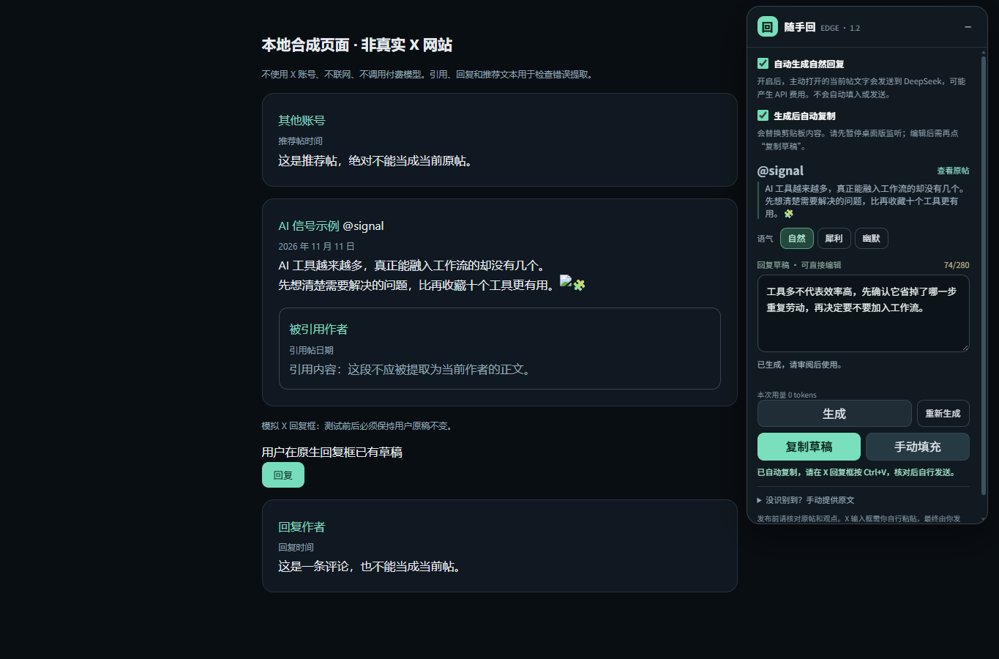

# 随手回 V1.2.1 · Edge 浏览器扩展

在你主动打开的 X 帖子详情页，识别当前原帖、生成中文回复，在页面旁审阅和编辑。开启「自动生成自然回复」后，新帖不需要再点生成。

V1.2 是现有随手回的扩展，继续复用 Python 的 DeepSeek 请求、三种回复提示词、模型设置和 Windows 凭据管理器。它不替换已有 Windows 桌面程序及其数据。仓库同时包含 v1.1.1 桌面源码，公开的完整桌面 EXE 仍为 v1.0.0；本扩展包中的 EXE 是独立本机通信组件。没有接入 Wingman-X，也没有新增账号或云数据库。

**同时开启两个开关后的流程：打开帖子 → 自动生成自然回复并复制 → 审阅 → 你在 X 回复框 Ctrl+V 粘贴并发送。** 「自动生成自然回复」和「生成后自动复制」都默认关闭；编辑草稿后需再点「复制草稿」。界面中的“手动填充”只复制并显示粘贴指引，不由脚本写入网页输入框；详见 [平台规则与技术边界](EDGE_PLATFORM_RULES.md)。本项目没有获得 X 官方授权或兼容性认证。

[下载 v1.2.1 ZIP](https://github.com/shui234/suishou-reply/releases/download/v1.2.1/SuishouReply-1.2.1-Edge-Windows.zip) · [GitHub Release 与校验文件](https://github.com/shui234/suishou-reply/releases/tag/v1.2.1)

## 安装

适用环境：Windows 11 x64 + Microsoft Edge。运行包不需要安装 Python，源码构建需要 Python。

1. 下载上方 `SuishouReply-1.2.1-Edge-Windows.zip`，**完整解压**到准备长期保存的本地目录；不要直接在压缩包内运行。
2. 双击解压目录内的 **Install.cmd**。它只为当前 Windows 用户注册本机通信组件，不需要管理员权限。不要直接双击 `SuishouReplyBridge.exe`，它是由 Edge 启动的后台通信程序。
3. 在 Edge 地址栏打开 `edge://extensions`，开启「开发人员模式」，点击「加载解压缩的扩展」，选择包内的 **extension** 文件夹，即包含 `manifest.json` 的那一层。
4. 核对扩展 ID：`pibjjmjbipbifeddoahjagcinihkcgnf`。若不同，不要扩大本机白名单；请重新使用完整、未改动的扩展文件夹。
5. 在原随手回桌面版的设置中保存 DeepSeek API Key。之前已保存过就直接复用；首次使用可下载保留的 [v1.0.0 桌面版](https://github.com/shui234/suishou-reply/releases/tag/v1.0.0) 配置。扩展没有密钥输入框，桌面应用无需常驻，Edge 会按需启动本机组件。
6. 由你自行在 Edge 登录 X，再打开一条帖子的独立详情页。已打开的页面首次安装后请刷新一次。

使用扩展时建议暂停桌面版剪贴板监听。旧桌面版无法识别浏览器复制的草稿来自扩展，若仍开着监听，可能把该草稿当作新复制文本再请求一次；本版没有远程切换旧 EXE 的监听状态。

安装后不要移动或删除目录。如果需要换位置，先在旧目录运行 Uninstall.cmd，移动后在新目录运行 Install.cmd，并重新加载新位置的 extension 文件夹。

安装器会在当前目录生成 `native-host.json` 和 `native-registration-backup.json`，分别记录本机路径与原注册值。它们不是公共发行文件，不要上传到 GitHub。

参考：[Microsoft 官方加载本地扩展说明](https://learn.microsoft.com/en-us/microsoft-edge/extensions/getting-started/extension-sideloading)。本扩展未上架 Edge Add-ons 商店，当前通过开发人员模式加载。

## 从已有 v1.2.0 升级

已经加载旧版扩展时，只刷新 X 页面不会升级扩展文件。先关闭已开启的自动开关并暂停桌面监听，再选择以下一种方式。

**保留原扩展路径，只更新浏览器功能：** 先备份原安装目录中的 `extension` 文件夹，再把新 ZIP 内 `extension` 文件夹的运行文件复制到原来已加载的 `extension` 文件夹，覆盖同名文件。在 `edge://extensions` 找到「随手回」，点击「重新加载」，确认版本显示 **1.2.1**，最后刷新已打开的 X 页面。这会保留原加载路径和扩展 ID；不移动或覆盖本机生成的注册文件。v1.2.1 的自动复制仍使用原通信协议，此方式继续运行已注册的旧桥接 EXE。

**同时升级桥接 EXE：** 将完整新包解压到新的长期目录；关闭 X 标签，在旧安装目录运行 `Uninstall.cmd`，再在新目录运行 `Install.cmd`。在 Edge 移除旧路径加载的扩展，重新加载新包的 `extension` 文件夹，然后刷新 X 页面。旧安装目录可保留作回退；原桌面 EXE、凭据与历史无需删除。移除再加载可能重置浏览器开关，使用前请重新确认。

看到页面面板或工具栏弹窗中的「生成后自动复制」后，再按需开启；默认不会替你打开。

## 使用

### 自动生成关闭时

应用只识别原帖，不调用模型。选择自然、犀利或幽默，点击「生成」；结果直接显示在可编辑草稿框中。

### 自动生成开启时

页面面板和扩展工具栏弹窗都可以切换「自动生成自然回复」。开关默认关闭，保存在浏览器本地配置中，重启浏览器后保留。

- 你在前台主动打开一个帖子详情页，原帖确定后自动请求一次「自然」回复。
- 当前页已经打开时开启开关，也会尝试生成一次。
- 重复渲染、收起／展开不会重复调用模型；同内容同风格优先复用会话缓存。
- 切换帖子、切换标签／窗口、页面关闭会取消旧任务；过期结果不会显示到新帖子。
- 草稿可以编辑；原帖正文变化或暂时重新加载时，保留手工草稿并提示你重新核对。
- 失败后显示原因，用户明确点击重试才再次请求。原帖和风格不变时，点击「重新生成」可强制换一个角度。
- 原生输入框、发送按钮、点赞和关注不受开关控制，扩展不操作它们。

**费用说明：开启自动生成后，符合条件的当前帖正文会发送给 DeepSeek，可能产生 API 费用。** 请求通常在 30 秒超时，不进行自动网络重试。取消本机等待不能保证服务端尚未处理或计费；缓存命中不产生新的模型调用。

### 使用草稿

草稿按原有回复提示词生成，通常 30～80 字、最多两句。你可以修改后点击「复制草稿」，或点击「手动填充」查看粘贴指引，再亲自选择当前帖的 X 回复框，Ctrl+V 粘贴，核对后手动发送。

### 生成后自动复制（v1.2.1）

页面面板和扩展弹窗中都有独立的「生成后自动复制」开关，默认关闭，重启浏览器后保留选择。开启会替换现有剪贴板内容；请先暂停桌面版的剪贴板监听，避免旧版收到浏览器草稿后再请求模型。

同时开启「自动生成自然回复」和「生成后自动复制」后：**打开帖子 → 生成并复制 → 看一眼 → 点击 X 回复框并按 Ctrl+V → 自己发送**。自动复制也适用于手动生成和重新生成，不会额外调用模型。

- 仅在当前帖子仍有效、浏览器页面仍在前台且结果符合长度限制时复制一次；同一结果重复回调或页面刷新组件不再写入。
- 打开开关不会立刻复制已有草稿。当前请求命中会话缓存时可以复制，本页已有草稿仅重新显示时不再次复制。
- 切帖、失焦、编辑中止的旧请求、API 错误和超长内容不会改动剪贴板。
- 草稿编辑后不会随着打字自动复制；点击「复制草稿」取得编辑后的最新版。
- 出现「自动复制未成功」时，点击手动复制；没有循环重试，也不会假报成功。
- 剪贴板异步操作一旦已经提交给浏览器，无法撤回；切换页面之前已完成的复制也不会自动恢复原剪贴板。

此功能使用扩展已有的 `clipboardWrite` 权限，只写入生成的文本，不读取系统剪贴板，也不操作 X 的回复框。参考 [WebExtensions 剪贴板说明](https://developer.mozilla.org/en-US/docs/Mozilla/Add-ons/WebExtensions/Interact_with_the_clipboard)。

面板显示保守加权字符计数，超长内容需自行缩短，不会静默截断你的稿件。长度检查不保证事实准确，也不能代替 X 编辑框的最终计数。

面板可以拖动、收起。窄窗口或没有足够侧边空间时默认收起，避免挡住主内容；主动展开后可按需要调整位置。

### 没有识别到原帖

识别依据当前详情 URL 与原帖自己的时间链接，排除引用、评论、推荐内容。图片无正文、多个同身份候选、页面结构变化或不支持的路由都会停止自动生成。

展开「没识别到？手动提供原文」，仅粘贴你正在看的原帖正文，再点击「使用这段原文」。不会调用隐藏接口或批量遍历时间线。手动原文也需要有效的帖子详情 URL；用户应核对来源是否匹配。

## 隐私与通信

```text
当前 X 页面中的随手回面板
          ↓ 受验证的扩展消息
Edge service worker
          ↓ Native Messaging（无 localhost 端口）
SuishouReplyBridge.exe
          ↓ 复用 Windows 凭据管理器、现有提示词及 QtNetwork
DeepSeek 官方接口
```

- 权限仅包括 Native Messaging、本地／会话存储、写剪贴板，以及 `x.com`、`twitter.com` 页面；不申请 Cookies、密码或所有网站权限。
- API Key 不进入扩展、不写入页面或日志。本机组件只接受固定字段，拒绝浏览器传入任意 API 地址、密钥、系统提示词和文件路径。
- 浏览器持久配置只保存自动开关。模型结果最多缓存 64 条于浏览器会话存储；关闭浏览器后不作为永久历史保存。编辑稿和近期处理标记在页面内存中有容量上限。
- 原有桌面原创历史仍由桌面模块管理，浏览器回复不混入该文件。
- 本机组件只为准确的扩展 ID 服务，并再次验证调用 origin、数据类型、帖子身份和消息大小。该边界不能抵御同一 Windows 用户下的恶意本地程序。
- 本机 stdin 关闭会取消请求并退出；闲置会自行退出，不安装 Windows 服务或开机任务。

## 目录与源码构建

```text
SuishouReply-1.2.1-Edge/
  Install.cmd / Uninstall.cmd
  install-native-host.ps1 / uninstall-native-host.ps1
  SuishouReplyBridge.exe
  extension/                 # 可直接加载的 MV3 扩展
  docs/                      # 本说明、平台规则、测试报告
  licenses/                  # 第三方许可
  BUILD_INFO.json / SHA256SUMS.txt
  source/                    # 扩展、本机桥接及复用模块源码
```

完整项目中运行：

```powershell
# 使用已安装 requirements-dev.txt 的开发环境
python -m pytest -q
node --test extension/tests/*.test.js
python scripts/build_edge.py
node extension/tests/browser-smoke.cjs
python scripts/package_edge.py
```

测试脚本需要 Node.js 22 或更高版本，不安装 npm 运行依赖。已验证环境为 Python 3.14.4、Node.js 24.14.1、PySide6 6.12.0、PyInstaller 6.22.3。`browser-smoke.cjs` 使用独立 Edge 配置、拦截的本地合成网页与 EXE 的显式模拟模式，不访问真实 X 页面或付费模型。

单独发行包的 source 子集可重建 Edge 组件并运行其专项测试，不能替代完整桌面项目；具体步骤见 `source/README-REBUILD.md`。完整源码在 [GitHub 仓库](https://github.com/shui234/suishou-reply)，对应安装包见 [v1.2.1 Release](https://github.com/shui234/suishou-reply/releases/tag/v1.2.1)。

## 卸载、回退与故障

1. 在原解压目录双击 **Uninstall.cmd**，恢复安装前的本机通信注册值。若已被其他安装修改，卸载器会保留那个新值。
2. 在 `edge://extensions` 移除扩展。原桌面版、密钥、设置和原创历史不受影响。
3. 要回到原流程，启动原来的随手回 EXE，按原方式使用剪贴板或「来一条」。旧 EXE 与 ZIP 均保留。

| 提示 | 处理 |
| --- | --- |
| 未连接本机组件 | 确认已完整解压并运行 Install.cmd，目录没有移动，扩展 ID 正确；手动重试 |
| 需要保存 API Key | 在原随手回桌面设置中配置，勿把密钥发到网页或扩展 |
| 余额不足／密钥无效／模型不可用 | 检查 DeepSeek 账户与原桌面模型设置，再主动重试 |
| 原帖无法确认 | 使用帖子详情页；必要时手动粘贴原文，避免引用帖或评论串入 |
| 扩展重载后旧页面断开 | 刷新该 X 标签；正常 worker 休眠在下一次明确操作或新帖导航时按需恢复 |
| 复制失败 | 在草稿框中全选并手动复制，再粘贴到 X |

## 验证状态

已执行的测试和仍未验收的项目见 [V1.2 测试报告](EDGE_TEST_REPORT.md)。实际 Edge 加载与合成网页检查不等于真实 X 网站验收；没有使用真实 DeepSeek 密钥验证付费调用或文案质量。真实站点检查需要用户自行登录，并由用户确认最终发布内容。


