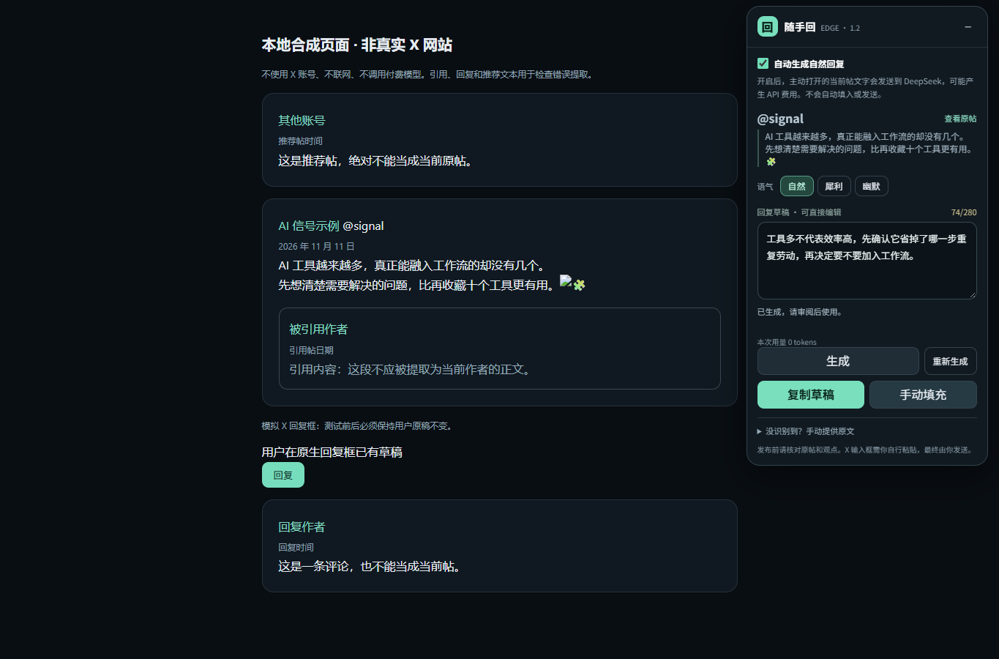

# V1.2 Edge 版测试与交付记录

验证日期：2026-11-11（Asia/Shanghai）。环境：Windows 11 x64、Python 3.14.4、PySide6 6.12.0、PyInstaller 6.22.3、Node.js 24.14.1、Microsoft Edge 156.0.4314.58。

## 已执行结果

| 检查 | 结果 | 证据与范围 |
| --- | --- | --- |
| 完整 Python 回归 | 360 项通过，退出码 0 | 包括原有 304 项及新增 45 项 Native 协议／桥接、11 项安装／包装测试 |
| 扩展 Node 测试 | 74 项通过，退出码 0 | 自动开关、草稿状态、DOM 候选、缓存、Worker、取消、布局和重连逻辑 |
| 实际 Edge 引擎集成 | 21 项通过 | 真实加载 MV3，页面为拦截后返回的本地 HTML，模型为已编译 EXE 的显式模拟模式 |
| 实际 Native Messaging | ping 返回 ready / 1.2.0 | Edge 原生通道连接发行 EXE；没有读取真实凭据或调用模型 |
| 安装／卸载 | 仿真注册表测试通过，并完成一次真实临时注册／恢复 | 安装前目标 HKCU 项不存在，结束后仍不存在；未留常驻注册 |
| 保留现有工作 | 已校验修改前 158 个文件 | 原有源码、测试和未提交增强不变；仅 README、CHANGELOG 增加 V1.2 文档 |

机器可读摘要见 [edge-verification.json](edge-verification.json)。旧版本的 42 项原生自检属于原桌面历史记录，未拿来当作本次扩展的验收结果。

## 主要场景

- 自动关闭时只识别原帖，不发送模型请求；开启后生成一次自然回复。
- 通过原帖自己的 permalink、作者和正文匹配当前 URL，排除引用帖、推荐帖及评论。
- 重复渲染、收起／展开不重复请求；内容或风格变化更新缓存身份，明确重新生成才强制请求。
- 快速切帖、关闭页面、切窗口和取消请求不会把旧回复带到下一帖。
- 草稿编辑后，未完成请求、原帖正文更新、React 临时卸载都不会覆盖手工稿。
- 编辑后的文本可以原样复制；“手动填充”只复制并显示 Ctrl+V 提示。合成原生输入框和发送按钮在检查前后均未被操作。
- 已有草稿重新生成失败后，重试会保留之前的风格与请求意图，成功前保留旧草稿。
- 模拟余额不足、密钥错误、超时、网络问题和无效响应，反馈明确且没有自动重试。
- SW 休眠后的下一次明确操作或新帖子导航可按需重连；关闭开关的最新意图不会被初始化旧值覆盖。取消挂起后的 Worker 仍可接入。
- 中文、Emoji、短 URL 和尾标点进行保守长度检查，超长只提示修改，不截断正文。
- 小窗口收起、宽窗口侧边停靠与拖动边界；800×600 下控件不越出视口。
- Native 消息类型、来源、帖子身份、数据长度、重复 JSON 键与控制字符检查；stdout 只输出协议帧，错误不输出密钥或服务原始正文。
- EOF 取消并退出，30 秒 API 超时和 60 秒空闲退出；部分帧读取线程不阻止进程终止。若已有请求刚超时，最坏退出时间可能接近 90 秒，不是固定 60 秒总进程寿命。

## 集成测试具体做了什么

`extension/tests/browser-smoke.cjs` 使用独立 headless Edge 配置，实际加载扩展，拦截测试目标导航并提供带“非真实 X 网站”标记的本地夹具。前台焦点采用测试仿真；本机传输在测试中通过 CDP 测试桥连接发行 EXE 的 `--synthetic` 模式。6 次模拟生成不使用真实密钥，不产生 API 费用。剪贴板写入替换为测试捕获，不覆盖用户系统剪贴板。

这验证了真实浏览器中的扩展代码、界面、消息、编译主机和生命周期协作；**没有验证真实 X DOM、真实模型质量或完整的付费账户链路**。

另运行 `extension/tests/native-ping.cjs`，在临时 HKCU 注册下，直接用 Edge 的 `sendNativeMessage` 向真实发行 EXE 发送 ping，确认浏览器原生通道、允许来源、安装路径和版本匹配。它没有替换 Native 通道，也没有生成正文。完成后执行卸载并检查注册恢复。

## 运行方法

完整项目的开发环境中：

```powershell
python -m pytest -q
node --test extension/tests/*.test.js
python scripts/build_edge.py
node extension/tests/browser-smoke.cjs
```

安装完成后可选执行只读 ping：

```powershell
node extension/tests/native-ping.cjs
```

独立源码子集可运行 `python -m pytest -q tests/test_edge_protocol.py tests/test_edge_bridge.py tests/test_edge_install.py`，以及上述 Node 测试。此子集没有包含桌面全量测试，360 项结果只适用于完整项目。

## 仍待完成／未承诺的项目

1. **真实 X 网站验收未完成。** 需要用户自行登录 Edge 中的 X，验证其当前页面结构、语言和账号界面。不能把合成页面通过描述成真实网站已通过。
2. **没有调用真实 DeepSeek。** 余额、账户模型可用性、文案自然度和事实准确性尚需少量人工验收。
3. **DOM 自动填框没有实现。** 因平台规则边界，交付的是明确标注的复制／手动粘贴方案，不是自动填充成功的假反馈；不存在绕过开关。
4. **未获得 X 平台授权。** 单帖最小读取不代表官方已批准这种扩展形式；规则说明单独保留。没有调用私有接口或访问 Cookies。
5. **未上架商店、EXE 未签名、未在另一台干净 Windows 安装验收。** 当前按开发人员模式加载；跨设备行为仍需检查。
6. **帖子识别采取保守策略。** 非标准路由、只有图片、超长帖或 X 改版时可能要求手动粘贴，避免把错误内容发送给模型。
7. **桌面与扩展是两个独立请求上下文。** 两边都主动生成时可能各有一次请求并分别计费；浏览器扩展内部单次生成不并发扩散。旧桌面监听不能识别浏览器复制的草稿来源，使用扩展时应先暂停桌面监听，避免这次复制再次触发桌面请求；本版不自动更改旧 EXE 的开关。

## 安全与回退

发行包采用明确白名单，不把整个脏工作区直接压缩；排除 API Key、用户配置、原创历史、注册备份、已有私人路径说明和临时文件。打包时检查运行文件与当前源码一致、EXE 哈希、版本和 ZIP CRC。此检查不是完整漏洞审计或渗透测试。

本次交付独立桥接 EXE，旧桌面程序和 v1.0.0／v1.1.0／v1.1.1 包继续保留。安装前的源代码快照与差异记录保存在工作目录的 `work/edge-v12-preserve`，不进入发行包。没有进行 Git reset、clean、分支切换或远程推送。




