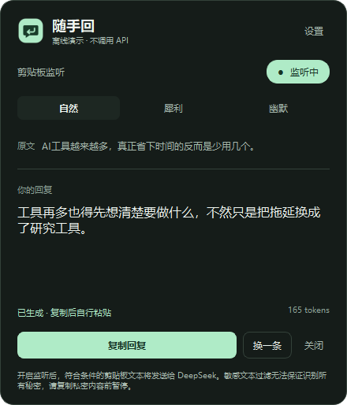

# 随手回 1.0.0 验证记录

验证日期：2026-11-08（Asia/Shanghai）。环境：Windows 11 x64、Python 3.14.4、PySide6-Essentials / Shiboken 6.12.0、PyInstaller 6.22.3。

## 自动化测试

执行 `python -m pytest -q`，**85 项通过，进程退出码 0**。

- 剪贴板：默认暂停、开启时不处理旧内容、12～3000 字范围、文件/图片/纯链接/代码排除、中文及英文密码/验证码/API Key 识别。
- 调度：350 ms 防抖、连续复制优先最新内容、会话去重、暂停取消、过期成功与错误回调丢弃。
- 复制：生成不修改原剪贴板；主动复制回复不会循环；专用 MIME 标记丢失时仍抑制；剪贴板历史恢复旧回复会取消中途任务。
- API：固定 HTTPS 地址、禁止重定向、关闭思考、单条回复、超时、手动取消、401/402/429/400/404/422/5xx、网络错误、异常/空/截断响应、token 数据校验、无自动重试。
- 凭据：使用隔离的临时凭据名称，在本机 Windows Credential Manager 实测保存、读取、覆盖、删除；未读取或发送用户真实密钥。
- 设置与界面：模型/风格/主题保存、无明文密钥字段、设置期间暂停、取消后不自动恢复、纯文本渲染、拖动、关闭仅隐藏、非激活窗口标志。

离屏测试曾发现 Qt 在销毁 Python QMimeData 时的退出崩溃。已用不含应用代码的最小程序复现，并仅在测试结束时清理离屏模拟剪贴板；实际应用退出不会清空用户剪贴板。

## 原生完整流程

执行 `python main.py --self-test --report <路径> --screenshot docs/preview-dark.png`：**19 项检查通过，退出码 0**。

自检使用原生 Windows Qt 窗口、QClipboard 和实际 QtNetwork HTTP 请求。本机 `127.0.0.1` 模拟服务返回合成回复；生产运行的服务地址固定为 DeepSeek。检查包含：

1. 默认暂停，开启不会发送现有剪贴板。
2. 模拟文本窗口按 Ctrl+C → 剪贴板监听 → 请求 → 显示。
3. 浮窗显示后，原输入窗口仍持有焦点。
4. 请求体使用 `deepseek-flash` 与 `thinking.type=disabled`。
5. 原文剪贴板保留，点击复制回复后没有新请求。
6. 手动换一条、连续复制优先最新、402 余额不足提示。
7. 不自动重试，敏感文本不发送，暂停后不发送。
8. 关闭只隐藏、TLS 后端可用、截图成功。

自检会在退出前恢复原剪贴板。截图内容完全来自模拟数据。

## 启动与打包

- `start.bat --prepare-only` 在含中文、空格、感叹号的路径中通过，退出码 0。
- 批处理的 Python Launcher 选择、环境创建、依赖安装标记和 `pythonw --demo` 参数转发已验证。该路径测试复用了本机已安装依赖，未声称在全新机器联网安装实测。
- 原生 `python main.py --smoke-test` 正常启动、退出，退出码 0。
- PyInstaller 单文件 EXE 构建完成，39,625,625 字节（约 37.8 MiB）。
- **最终 EXE 自检 19/19 通过，退出码 0**；结果见 [exe-self-test.json](exe-self-test.json)。包括原生剪贴板、QtNetwork 本地 HTTP、浮窗不抢焦点和 TLS 后端。
- 正式 EXE 的首次启动设置窗口已用 Windows 界面工具实测检查：密钥输入为空、模型为 `deepseek-flash`、默认自然/深色、监听暂停、隐私说明与测试连接入口均正确显示。
- 最终构建元数据见 `dist/BUILD_INFO.json`；SHA-256：`041c221451fc63a868fa17f3a48e0f20e65e28a0c3f33a49d176057702f36e58`。

首轮打包发现宿主 PATH 中另一软件的 ICU DLL 被 PyInstaller 错误收集，造成 QtCore 导入失败。构建脚本通过隔离构建子进程的 DLL 搜索路径修复；最终 EXE 已重新构建并完成以上实际运行验证。

## 验证边界

没有使用真实 DeepSeek API Key，因此**未验证真实账户余额、网络链路及模型回复质量**。用户在设置内填写自己的密钥后，可点击「测试连接」完成真实服务验证，该操作会产生一次 API 调用。

敏感文本检测是规则过滤，不能识别所有秘密，也可能误拦普通文字。开启监听会把符合条件的新剪贴板文本发给 DeepSeek，应用无法确认内容是否来自 X。隐私提示已在主浮窗和设置中显示。

EXE 未签名；未在另一台全新 Windows 电脑逐一验证。构建信息包含最终依赖版本、EXE 大小和 SHA-256，可据此检查产物。
